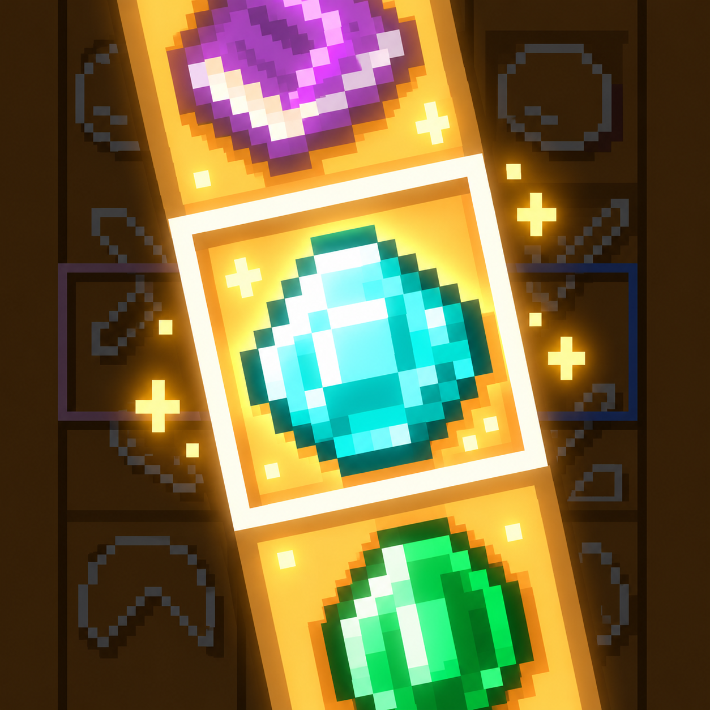
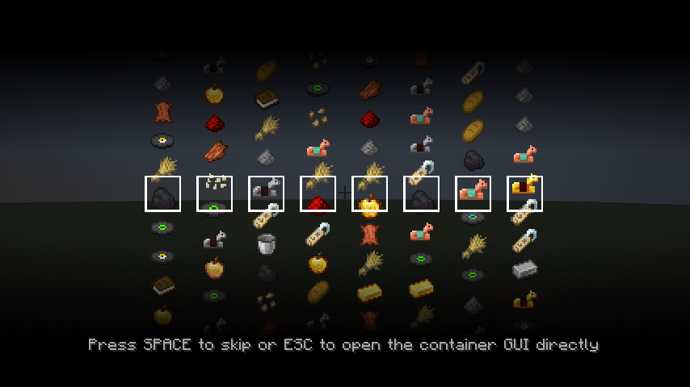
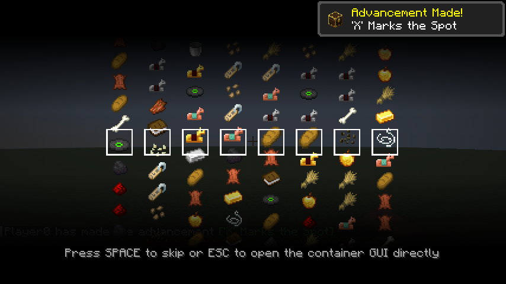

<p align="center">
  
</p>

# Super Gacha

**Minecraft 26.3 · Fabric · Java 25**

A visual loot-reveal mod: open a loot chest and watch its rewards roll into view
with animated reels, rarity colors, and reward sounds.

**Port created and maintained by [alvyn16](https://github.com/alvyn16).**
Based on **[GachaAddiction](https://github.com/Wang-Xiao-Jing/GachaAddiction)** by
**[XiaoJin / Wang-Xiao-Jing](https://github.com/Wang-Xiao-Jing)**. Credit for the
original mod and upstream Fabric implementation belongs to its authors.
Super Gacha is an unofficial community port; please report port issues here.

[中文](README_ZH.md) · [Credits](CREDITS.md) · [Port details](PORTING.md)

## See it working

These are actual Minecraft 26.3 screenshots captured during automated gameplay
tests, not mockups. The tests open real loot containers, render the reveal,
exercise skip controls, and check that rewards remain available afterward.

### Vanilla loot chest



### Lootr chest



## Features

- Animated slot-machine loot reveals with decoy items and rarity colors.
- Loot tables from vanilla and data packs.
- Optional Lootr integration for per-player loot containers.
- Reward sounds, item merging, sorting, and configurable filters.
- SPACE skips the current reel; ESC returns to the container immediately.
- Administrator `/gacha` command for granting and revealing loot-table rewards.

## Install

Use **Minecraft 26.3**, **Java 25+**, **Fabric Loader 0.19.5+**, and **Fabric API
for 26.3**. Install the mod and Fabric API on both the client and server.
Lootr is optional; the tested Fabric version is **1.25.42.124**.

Download the built JAR from this repository's **Actions → Build → Artifacts**, or
build it using the commands below. Install `super-gacha-1.2.0+26.3.jar` in your
`mods` folder. Do not install the `-sources.jar`.

Super Gacha preserves the `gachaaddiction` mod ID for compatibility. Install only
one of Super Gacha or GachaAddiction, because they share that ID.
Configuration remains at `config/gachaaddiction-client.json`.

## Commands and compatibility

The original commands, IDs, configuration paths, and resource-pack paths stay
the same. For example:

```text
/gacha @s gachaaddiction:slot_machine minecraft:chests/simple_dungeon 1
```

The visible mod name is **Super Gacha**, and the built JAR is named
`super-gacha`. Existing Java package names and `gachaaddiction:*` identifiers are
retained deliberately.

## Build and test

With JDK 25 installed, run:

```powershell
.\gradlew.bat build
.\gradlew.bat runClientGameTest -PwithoutLootr
.\gradlew.bat runClientGameTest
.\gradlew.bat runGameTest -PwithoutLootr
```

On Linux/macOS, use `./gradlew` instead. The installable JAR is written to
`build/libs/super-gacha-1.2.0+26.3.jar`.

Client tests check real vanilla/Lootr chest reveals, rendering, skip controls,
loot retention, reopening, and `/gacha` inventory/overflow rewards. Server-only
tests check startup, loot-table caching, block containers, double chests, and
chest minecarts. Runtime screenshots and logs are written under `build/run/`;
checked-in screenshots are in `docs/`.

The upstream NeoForge-only integrations are outside the existing Fabric port's
scope. See [PORTING.md](PORTING.md) for the exact integration list and provenance.

## Credits and license

- **Port creator and maintainer:** alvyn16.
- **Original mod creator:** XiaoJin / Wang-Xiao-Jing, GachaAddiction.
- **Fabric base:** upstream `fabric/26.2`, commit
  `329fc1eef26c1e54c92ca8296ac8270c2fa8cbfe`.

The upstream [LICENSE](LICENSE) file (GNU LGPL 3.0) is retained. Older upstream
README files described a different license; this port preserves the actual
license file. See [CREDITS.md](CREDITS.md) for full attribution.
